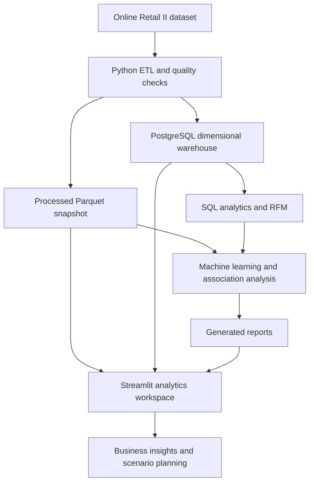

# RetailIQ AI

**Retail decision intelligence | Data engineering · BI · Machine learning**

RetailIQ AI is an end-to-end retail analytics portfolio project that transforms historical transaction data into business intelligence, customer insights and predictive analytics through a Streamlit workspace. It combines an ETL pipeline, a PostgreSQL dimensional warehouse, SQL analysis and explainable machine learning.

   

## Business problem

Retailers need to understand revenue performance, identify valuable customers, anticipate inactivity, explore product affinities and plan future sales. RetailIQ AI brings these tasks together in an interactive decision-support application.

## Historical dataset at a glance

| Measure | Project run |
| --- | ---: |
| Cleaned transaction lines | 1,033,031 |
| Net revenue | £19.01M |
| Identified customers | 5,942 |
| Product codes | 5,304 |
| Markets | 43 |
| Observation period | Dec 2009 – Dec 2011 |

Figures describe historical data, not the performance of a live business. Results may vary if preprocessing changes.

## Product capabilities

| Workspace | Analytical capabilities |
| --- | --- |
| Executive overview | Revenue, customer and return KPIs; interactive filters |
| Sales, products and customers | Revenue trends, geographic performance, product and customer ranking |
| Segmentation | RFM analysis and K-means clustering |
| Churn risk | Classifier comparison and historical risk predictions |
| Forecast | Thirty-day recursive revenue forecast |
| Market basket | Apriori and association rules |
| Customer value | Predicted next 90-day spending using Random Forest |
| Anomaly detection | Rolling z-score revenue flags |
| Explainable AI | SHAP explanations for the customer value model |
| Business insights and planning | Recommendations and what-if scenario analysis |
| Data workspace | Data quality checks and CSV validation preview |
| Access | PostgreSQL-backed account registration and sign-in; historical guest demo |

## System architecture



The warehouse uses a sales fact table and date, customer, country and product dimensions. The application supports a historical Parquet snapshot and a configured PostgreSQL connection; guest access uses the local snapshot.

## Machine learning evaluation

| Task | Method / historical result |
| --- | --- |
| Customer segmentation | K-means; selected K=2; silhouette approximately 0.439 |
| Customer churn | Logistic Regression, Random Forest and Gradient Boosting; best observed ROC-AUC approximately 0.718 |
| Revenue forecasting | Linear Regression, Random Forest and Gradient Boosting; MAE/RMSE comparison |
| Market basket | Apriori; support, confidence and lift (UK subset) |
| Customer value | Random Forest regression; chronological validation and baseline MAE comparison |

Churn model selection used the observed holdout scores; independent final testing is still needed. Forecast errors measure one-day-ahead predictions, not independently validated 30-day recursive accuracy. Churn represents an operational inactivity definition, not confirmed customer loss. Predicted value is 90-day spending, not full lifetime profit. Anomaly flags are not confirmed fraud.

## Getting started

From the repository root, on Windows PowerShell (Python 3.11 recommended):

```powershell
py -3.11 -m venv .venv
.\.venv\Scripts\python.exe -m pip install -r requirements.txt
```

Download the Online Retail II workbook from [UCI Machine Learning Repository](https://archive.ics.uci.edu/dataset/502/online+retail+ii), extract it and place it at `data/raw/online_retail_II.xlsx`. Then run:

```powershell
.\.venv\Scripts\python.exe -m retailiq.etl data/raw/online_retail_II.xlsx
.\.venv\Scripts\python.exe -m streamlit run dashboard_luxe.py --theme.base light
```

Open `http://localhost:8501` and select recruiter demo access to explore the local historical snapshot. To use the database-backed features, configure a PostgreSQL database using the SQL schema and project loading workflow, and set `DATABASE_URL` in a private `.env` file. The account store may use `AUTH_DATABASE_URL` separately. Never commit these credentials.

The clustering, churn, forecasting and market basket pages consume generated CSV reports under `reports/`. Regenerate the relevant reports using the project modules and configured warehouse where required. The dashboard shows an unavailable-report message if these artifacts are absent.

## Repository layout

```text
RetailIQ-AI/
├── dashboard_luxe.py       # Streamlit application
├── retailiq/               # ETL and analytical modules
├── sql/                    # Warehouse schema and SQL analytics
├── requirements.txt       # Python dependencies
├── .env.example           # Configuration example (no real secrets)
└── README.md
```

Local data, generated models and reports are excluded initially; review them before publishing a demo snapshot. Deployment and screenshots will be added after validation.

## Dataset attribution

Chen, D. (2012). *Online Retail II* [Dataset]. UCI Machine Learning Repository. https://doi.org/10.24432/C5CG6D. Licensed under CC BY 4.0. The project processes the original data and retains signed returns and sales with missing customer identifiers. Exact duplicate removal may also remove legitimate identical lines where unique source line IDs are absent.

## Author

**N. Lalu Prasad** — M.Tech Data Science portfolio project.
